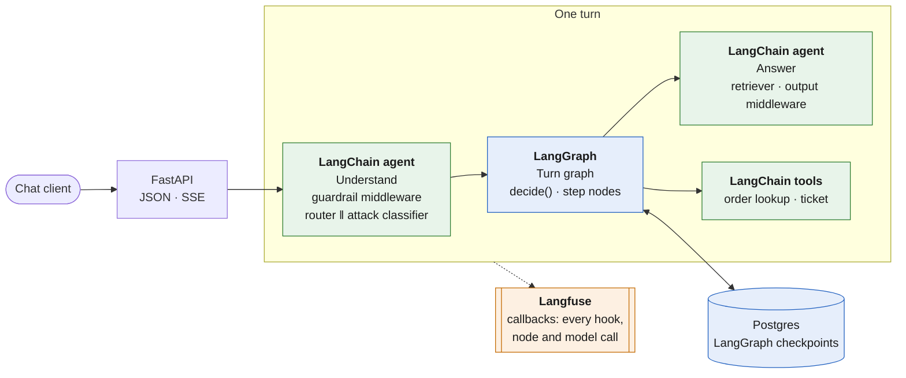
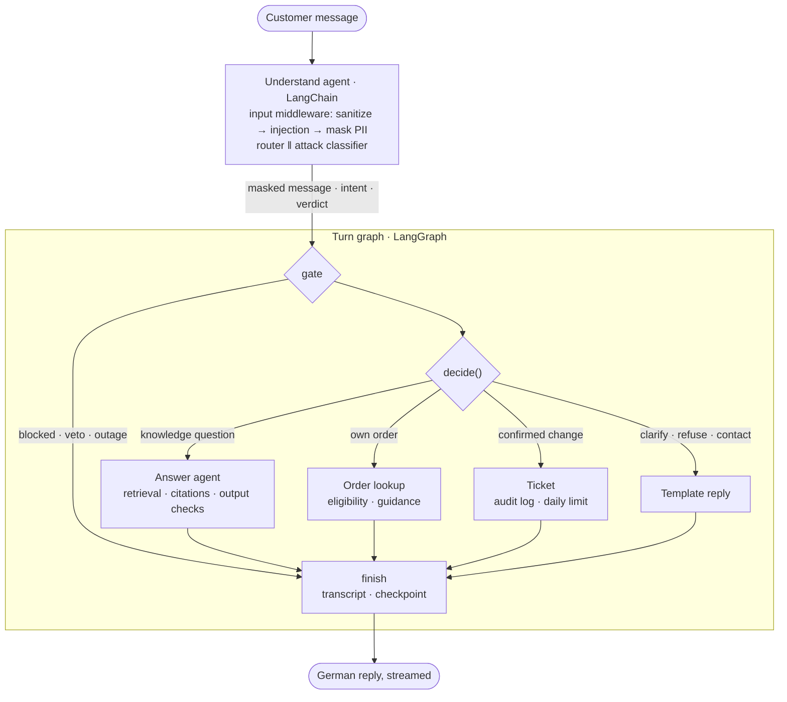
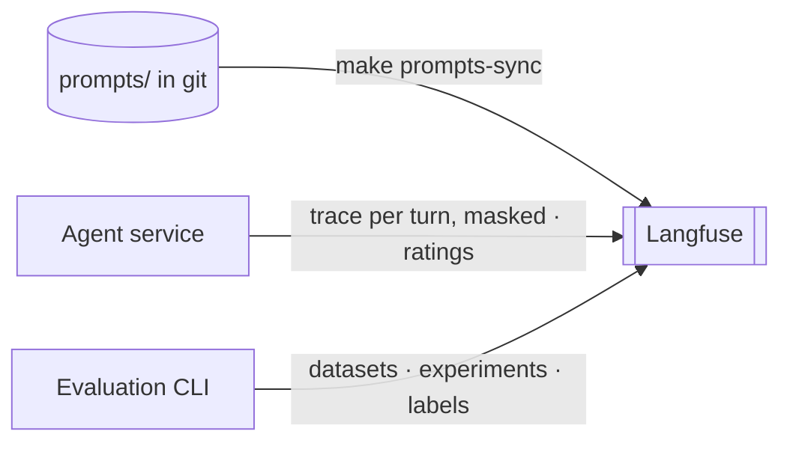

# NordElektro Customer Service Agent

[](https://github.com/haoran-yang-henry/customer-chatbot/actions/workflows/ci.yml)


A German-language AI customer service agent for an online electronics retailer, built on
**LangChain**, **LangGraph** and **Langfuse**. Customers ask in German about returns, shipping,
payment, warranty, products or their own orders, and get precise answers that are grounded in a
governed knowledge base and cite their sources.

The agent **informs and guides; it never changes data on its own**. Order questions are answered
from read-only order data with deterministic policy checks. A request to change data becomes a
ticket for the service team once the customer has confirmed it. Language models classify and
write; code decides.

## Architecture

### LangChain, LangGraph, Langfuse



| | Role in this project |
|---|---|
| **LangChain** | Chat models, embeddings and prompts; two tool-less agents whose guardrails run as middleware; a hybrid retriever (German full-text + vector); two tools that no model ever chooses |
| **LangGraph** | One turn as a graph around the pure state machine `decide()`; each conversation's masked transcript and state as a Postgres checkpoint |
| **Langfuse** | A trace per turn with every middleware hook, graph node and model call; prompt versions synced from git; evaluation experiments, judge calibration and customer ratings |

### One turn

Stage 1 understands the message and keeps nothing; only the masked message goes on. Stage 2
decides and acts, and is the only part with memory.



- **The model proposes, code decides.** The router suggests an intent; `decide()`, a pure and
  fully tested function, picks the step. The agents are created without tools (checked by a
  test); the graph's nodes call the tools, with customer and tenant from the verified token.
- **Defence in depth.** Deterministic checks first, an LLM attack classifier as second opinion,
  personal data masked before any model, transcript or log sees it, untrusted documents quoted as
  data, and every answer checked for citations, language, leaks and unverifiable links or codes.
- **Streaming and outages.** Tokens stream over Server-Sent Events; the final event is
  authoritative, because the output checks may still replace a draft. If the model provider
  fails, a circuit breaker answers with the service team's contact details within seconds.

### What goes to Langfuse



Every payload passes the same personal-data masking as the logs before it leaves the process.
Each model call in a trace is tied to the prompt version it used; the service still renders its
prompts from git, so tests and CI never need Langfuse. Langfuse is optional: unset keys switch it
off, and an outage only loses traces.

## Quality

| Area | Method | Result |
|---|---|---|
| Answer quality | 81 German conversations: behaviour, intent, sources, tools, required and forbidden phrases | **80 / 81** |
| Groundedness | LLM judge on every knowledge answer, calibrated against human labels (97 % agreement) | **33 / 34** |
| Retrieval | Recall@5 / MRR on 36 questions, confirmed on 28 held-out ones | **1.00 / 0.95** (held-out 1.00 / 0.87) |
| Safety | 37 attacks: direct and indirect injection, obfuscation, exfiltration, social engineering | **0 / 37** succeeded |
| Over-blocking | Benign conversations stopped by a guardrail | **0 / 87** |
| System overhead | k6, 20 concurrent customers, model mocked out | **p95 149 ms** (target ≤ 300 ms) |
| Resilience | Model provider unreachable | contact details in every turn, **< 10 s** |

The rebuild on LangChain, LangGraph and Langfuse was checked step by step: every step replayed
the model requests recorded before it byte for byte, and the full evaluation ran against the old
agent as a baseline (79 / 81, 2 / 37 attacks). The one remaining failure (G-004) is a router
boundary case that failed before as well.

## Getting started

**Prerequisites:** Python 3.12, [uv](https://docs.astral.sh/uv/), Docker, an OpenAI API key for
embeddings, and an API key for an OpenAI-compatible chat model.

```bash
cp .env.example .env          # set CA_OPENAI_API_KEY and CA_LLM_API_KEY
make install                  # dependencies and git hooks
make up migrate seed ingest   # Postgres + Keycloak, schema, demo orders, knowledge index
make run                      # API on http://localhost:8000, OpenAPI UI at /docs
```

```bash
curl -s localhost:8000/v1/chat -H 'content-type: application/json' \
  -d '{"message": "Wie lange habe ich Zeit, um einen Artikel zurückzuschicken?"}'
```

```json
{
  "session_id": "8f3c…",
  "answer": "Sie können Artikel innerhalb von 30 Tagen zurücksenden …",
  "behavior": "answer",
  "intent": "RETURN_POLICY",
  "sources": ["policy-returns-v5"],
  "request_id": "a1b2c3d4e5f6",
  "feedback_requested": false
}
```

Order questions need a logged-in customer: `make token USER=anna.schneider` prints a token for a
demo customer; send it as `Authorization: Bearer <token>`. With the `LANGFUSE_*` keys in `.env`,
run `make prompts-sync` once and every turn appears in Langfuse.

**Browser demo.** A small chat page ([`frontend/`](frontend/public): static files, no build step)
is published to GitHub Pages and signs in with OpenID Connect against Keycloak.
`make demo-public` exposes this machine through a Cloudflare quick tunnel behind a proxy that
lets only chat, health and login through; `make demo-public-down` stops it.

## API

| Endpoint | Description |
|---|---|
| `POST /v1/chat` | Send a message; omit `session_id` to start a conversation, then send the returned one |
| `POST /v1/chat/stream` | Same, as Server-Sent Events: `delta` events, then one authoritative `final` event |
| `POST /v1/feedback` | 👍/👎 and an optional comment, after a reply with `feedback_requested: true` |
| `GET /health/live` · `GET /health/ready` | Liveness (process) and readiness (database, checkpoint tables) |
| `GET /metrics` | Prometheus metrics, for the scraper only |

`behavior` says what happened: `answer`, `action` (about the customer's order), `clarify`,
`refuse`, `escalate` (ticket number or contact details) or `no_answer`. A second message while a
turn of the same session is running gets `409`. Errors follow RFC 9457; every response carries an
`x-request-id`. A sampled share of longer conversations (three rounds or more) is asked once
whether it helped.

## Configuration

Environment variables with the prefix `CA_` (see [`.env.example`](.env.example)):

| Variable | Purpose |
|---|---|
| `CA_DATABASE_URL` | PostgreSQL with pgvector |
| `CA_OPENAI_API_KEY`, `CA_EMBEDDING_MODEL` | Embedding model |
| `CA_LLM_API_KEY`, `CA_LLM_BASE_URL`, `CA_LLM_MODEL` | Chat model (any OpenAI-compatible endpoint); `CA_ROUTER_*` / `CA_ANSWER_*` per role |
| `CA_AUTH_ISSUER`, `CA_AUTH_AUDIENCE`, `CA_AUTH_REQUIRED` | OpenID Connect; unset issuer = anonymous only |
| `LANGFUSE_PUBLIC_KEY`, `LANGFUSE_SECRET_KEY`, `LANGFUSE_BASE_URL` | Langfuse; unset = off, never on with `CA_APP_ENV=test` or `ci` |
| `CA_FEEDBACK_SAMPLE_RATE`, `CA_FEEDBACK_MIN_ROUNDS` | Share of conversations asked for feedback (0.3), from which round (3) |
| `CA_RETENTION_DAYS` | Conversations without a turn for this long are deleted by `make retention` (90) |
| `CA_RATE_LIMIT_PER_MINUTE`, `CA_BREAKER_*`, `CA_LOG_FORMAT`, `CA_OTEL_ENDPOINT` | Rate limit, circuit breaker, JSON logs, OTLP traces |

## Operations

- **Logs, traces, metrics.** One JSON line per event with `request_id`, `session_id` and
  `trace_id`; one OpenTelemetry trace per request (Jaeger: `make up-observability`); Prometheus
  metrics for latency, tokens, guardrail decisions and circuit breakers. Personal data is masked
  before anything is written.
- **Conversations.** The masked transcript and state live in a LangGraph checkpoint per session;
  a lease admits one turn per session at a time. Run `make retention` daily to delete
  conversations past the retention period.
- **Security.** Identity only from verified tokens, customer- and tenant-scoped data access in
  SQL, an append-only audit log of every order lookup and ticket, a non-root container, and
  secret, dependency and image scans in CI.

## Development

| Command | What it does |
|---|---|
| `make check` | Lint, format check, strict type check, unit and data tests; no Docker or keys needed |
| `make test-integration` | Tests against a throwaway PostgreSQL (Testcontainers) |
| `make eval-smoke` | The CI quality gate: 24 conversations with recorded model answers, no keys |
| `make eval` · `make eval-redteam` | Full evaluation and red team against the real model; `LANGFUSE=1` records Langfuse experiments |
| `make load-test` | k6 load test with the model mocked out |
| `make audit` · `make deps-check` | Secret and vulnerability scans; unused packages and dead code |
| `make prompts-sync` | Publish the prompt versions from `prompts/` to Langfuse |

Every pull request runs four CI jobs: **check** (lint, types, unit and integration tests),
**eval-gate** (the real agent on 24 smoke conversations; all must pass), **security** and
**image** (build, scan, start without a database). The evaluation gate makes no model call:
`make eval-smoke-record` stores the model's answers in `eval/cassettes/smoke.json.gz`, CI replays
them, and any change to a prompt, the evidence or the chunking misses the recording until it is
re-recorded with the change.

## Project structure

```text
src/customer_agent/
  api/              HTTP endpoints, authentication, rate limit, error format
  application/      understand agent, turn graph, answer agent, guardrails, tools, retriever
  domain/           intents, state machine, order rules, knowledge metadata, personal data
  infrastructure/   PostgreSQL, checkpoints, chat models and embeddings, circuit breakers
  observability/    logs, traces, metrics, Langfuse
  evaluation/       datasets, scoring, LLM judge, Langfuse experiments
data/               knowledge base (Markdown), demo customers and orders
eval/               evaluation datasets, results and the CI cassette
prompts/            versioned prompt templates (source of the Langfuse prompts)
frontend/           browser demo (GitHub Pages)
migrations/         database schema (Alembic)
tests/              unit, data, integration and load tests
```

Inner layers never import outer ones and the domain imports no framework (both checked by a
test). Design records, requirements, the threat model and the evaluation plan are kept in a local
`docs/` folder outside this repository.
