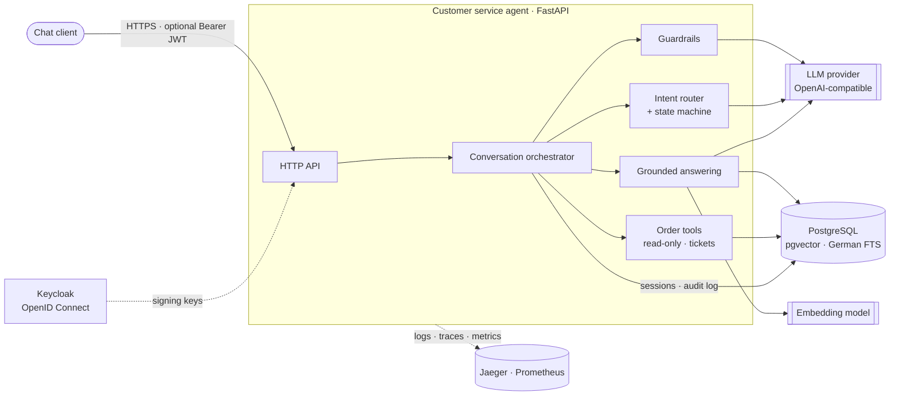
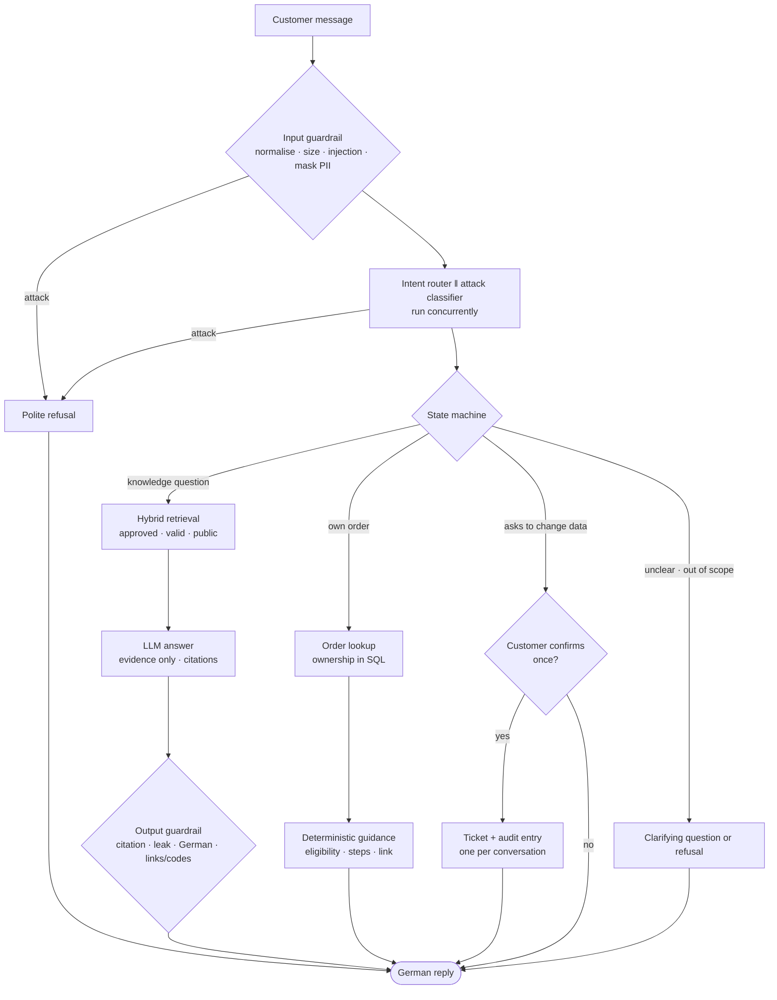
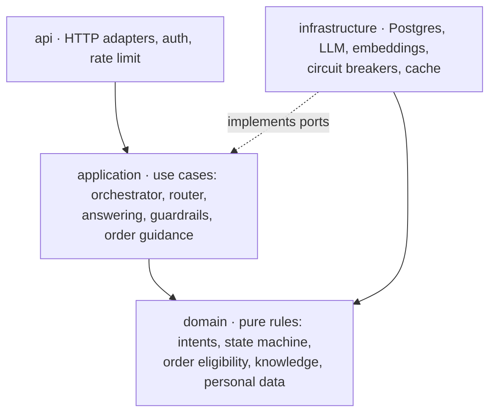
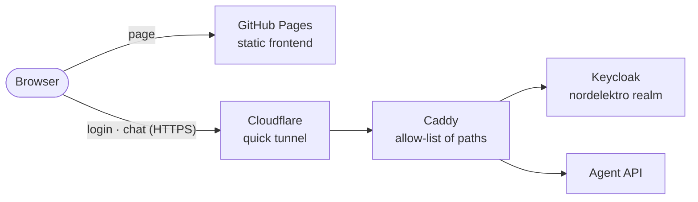

# NordElektro Customer Service Agent

[](https://github.com/haoran-yang-henry/customer-chatbot/actions/workflows/ci.yml)


A German-language AI customer service agent for an online electronics retailer. Customers ask
in German — about returns, shipping, payment, warranty, products or their own orders — and get
precise German answers that are grounded in a governed knowledge base, cite their sources, and
never promise what the shop has not written down.

The agent **informs and guides; it never changes data on its own**. Order questions are answered
from read-only order data with deterministic policy checks. A request to change data — an
address, an order, account details — goes to the service team as a ticket once the customer has
confirmed it; questions never create tickets.

## Highlights

| | |
|---|---|
| **Grounded answers** | Hybrid search (German full-text + vector) over approved, currently valid documents; every answer cites them, or says honestly that it cannot answer |
| **Order help without risk** | Status, cancellation and return eligibility from read-only order data; ownership is enforced in SQL; no tool can modify an order |
| **Explicit conversation state** | An LLM classifies the intent; a deterministic state machine decides the next step — the model proposes, code decides |
| **Defence in depth** | Prompt-injection heuristics, an LLM attack classifier, personal-data masking, untrusted content quoted as data, output checks for leaks and unverifiable links or codes |
| **Production-shaped operations** | Structured logs, one trace per request, Prometheus metrics, circuit breakers, rate limiting, health probes, a scanned container image |
| **Measured, not assumed** | Versioned evaluation datasets, a red-team set and load tests; every change is judged by them |

## Architecture

A modular monolith with ports and adapters: one deployable service with strict internal
boundaries, backed by PostgreSQL, an OpenID Connect identity provider and an OpenAI-compatible
model provider.



### How one message is handled



Answers stream token by token over Server-Sent Events; the final event is authoritative, because
the output guardrail may still replace a draft. If the model provider fails, timeouts and a
circuit breaker answer with the service team's contact details within seconds.

### Code organisation



Inner layers never import outer ones (enforced by a test). Adapters are wired in a single
composition root (`bootstrap.py`), which keeps the domain free of I/O and easy to test.

## Quality

| Area | Method | Current result |
|---|---|---|
| Answer quality | 81 German conversations: behaviour, intent, sources, tools, required and forbidden phrases | **80 / 81** passed |
| Retrieval | Recall@5 / MRR on 36 questions; confirmed on 28 held-out questions | **1.00 / 0.95** (held-out 1.00 / 0.87) |
| Safety | 37 attacks: direct and indirect injection, obfuscation, data exfiltration, social engineering | **0 / 37** attacks succeeded, no harmful output |
| Over-blocking | Benign conversations stopped by a guardrail, incl. device words such as "jailbreak" | **0 / 87** |
| System overhead | k6, 20 concurrent customers, model mocked out | **p95 54 ms** |
| Time to first token | 56 questions against the real model, one after another | p50 5.6 s, p95 7.2 s — above the 3 s target; one bare call to the development provider already takes 3–4 s |
| Resilience | Fault injection: model provider unreachable | Contact details in every turn, **< 10 s** |

Intent routing is done by a language model, so borderline cases can flip between runs: the
one failure (A-004, "Kopfhörer") is always clarified correctly, but labelled with the expected
intent in only about 30 % of samples. Groundedness is additionally scored by an LLM judge; its
verdicts are not yet calibrated against human labels and are therefore not listed as a result.

## Getting started

**Prerequisites:** Python 3.12, [uv](https://docs.astral.sh/uv/), Docker, an OpenAI API key for
embeddings, and an API key for an OpenAI-compatible chat model.

```bash
cp .env.example .env          # set CA_OPENAI_API_KEY and CA_LLM_API_KEY
make install                  # dependencies and git hooks
make up migrate seed ingest   # Postgres + Keycloak, schema, demo orders, knowledge index
make run                      # API on http://localhost:8000, OpenAPI UI at /docs
```

Try it:

```bash
curl -s localhost:8000/v1/chat -H 'content-type: application/json' \
  -d '{"message": "Wie lange habe ich Zeit, um einen Artikel zurückzuschicken?"}'
```

The response (shortened):

```json
{
  "session_id": "8f3c…",
  "answer": "Sie können Artikel innerhalb von 30 Tagen zurücksenden …",
  "behavior": "answer",
  "intent": "RETURN_POLICY",
  "sources": ["policy-returns-v5"],
  "request_id": "a1b2c3d4e5f6"
}
```

Order questions need a logged-in customer: `make token USER=anna.schneider` prints a token for a
demo customer; send it as `Authorization: Bearer <token>`. To run the API as a container instead,
use `make up-app`.

### Browser demo

A small chat page ([`frontend/`](frontend/public): static files, no build step, no dependencies)
is published to GitHub Pages. It signs in with OpenID Connect (authorization code flow with PKCE)
against Keycloak and streams the answers. The backend is not hosted anywhere: `make demo-public`
exposes this machine through a Cloudflare quick tunnel and prints a link plus a fresh password
for the three demo customers.



- Only chat, health and the realm's login endpoints pass the proxy; the Keycloak admin and
  account consoles, `/metrics` and the API docs do not.
- Chat requires a login (`CA_AUTH_REQUIRED`), browser origins are allow-listed
  (`CA_CORS_ORIGINS`), each customer may send 10 messages a minute, and Keycloak locks an account
  after repeated failed logins.
- The link works while this machine runs; `make demo-public-down` stops it. `make demo-frontend`
  serves the page locally on port 3000 for development.

## API

| Endpoint | Description |
|---|---|
| `POST /v1/chat` | Send a message; omit `session_id` to start a conversation, then send the returned one |
| `POST /v1/chat/stream` | Same, as Server-Sent Events: `delta` events, then one authoritative `final` event |
| `GET /health/live` · `GET /health/ready` | Liveness (process) and readiness (database) probes |
| `GET /metrics` | Prometheus metrics — expose to the scraper only |

`behavior` tells the client what happened: `answer`, `action` (based on the customer's order),
`clarify`, `refuse`, `escalate` (forwarded with a ticket number, or the service team's contact
details) or `no_answer`. Errors follow
RFC 9457 (`application/problem+json`); every response carries an `x-request-id`.

## Configuration

All settings are environment variables with the prefix `CA_` (see `.env.example`).

| Variable | Purpose |
|---|---|
| `CA_DATABASE_URL` | PostgreSQL with pgvector |
| `CA_OPENAI_API_KEY`, `CA_EMBEDDING_MODEL` | Embedding model |
| `CA_LLM_API_KEY`, `CA_LLM_BASE_URL`, `CA_LLM_MODEL` | Chat model (any OpenAI-compatible endpoint); `CA_ROUTER_*` / `CA_ANSWER_*` override per role |
| `CA_AUTH_ISSUER`, `CA_AUTH_AUDIENCE` | OpenID Connect issuer and audience; unset = anonymous only |
| `CA_AUTH_REQUIRED`, `CA_CORS_ORIGINS` | Reject anonymous chat; browser origins allowed to call the API (comma-separated) |
| `CA_LOG_FORMAT`, `CA_OTEL_ENDPOINT` | `json` logs for collectors; OTLP/HTTP endpoint for traces |
| `CA_RATE_LIMIT_PER_MINUTE`, `CA_ROUTER_TIMEOUT_SECONDS`, `CA_BREAKER_*` | Rate limit, timeouts, circuit breaker |

## Operations

- **Logs** — one JSON object per line with `request_id`, `session_id` and `trace_id`; personal data
  (e-mail, phone, IBAN, card numbers, secrets) is masked before anything is written.
- **Traces** — one OpenTelemetry trace per request with a span per step (guardrails, routing,
  retrieval, model calls, tools). `make up-observability` starts Jaeger at http://localhost:16686.
- **Metrics** — request and step latencies, LLM tokens and time to first token, guardrail
  decisions, circuit breaker states, rate-limit rejections.
- **Resilience** — per-role timeouts with one retry, a circuit breaker per provider, contact
  details when the model is down, rate limit per customer or client address.
- **Security** — identity only from verified tokens, tenant- and customer-scoped data access,
  append-only audit log of every order lookup and ticket, non-root container, dependencies and
  images scanned in CI.

## Development

| Command | What it does |
|---|---|
| `make check` | Lint, format check, strict type check, unit and data tests — no Docker or keys needed |
| `make test-integration` | Repository tests against a throwaway PostgreSQL (Testcontainers) |
| `make eval` · `make eval-redteam` | End-to-end evaluation and red team against the real model (cached) |
| `make eval-smoke` | The CI quality gate locally: smoke conversations with recorded model answers, no keys |
| `make load-test` | k6 load test with the model mocked out |
| `make audit` | Secret, vulnerability and misconfiguration scans (gitleaks, Trivy, pip-audit) |

Every pull request runs four CI jobs: **check** (lint, types, unit and integration tests),
**eval-gate** (the real agent, database and retrieval on 24 smoke conversations; every one must
pass), **security** (gitleaks over the full history, Trivy, pip-audit) and **image** (build,
vulnerability scan, smoke start). Actions are pinned to commit SHAs and images to digests.

The evaluation gate needs no API key and makes no model call: `make eval-smoke-record` stores the
model's answers for the smoke conversations in `eval/cassettes/smoke.json.gz`, and CI replays them.
Any change to a prompt, the evidence or the chunking alters a request, misses the recording and
fails the gate until the cassette is re-recorded and committed with the change.

## Project structure

```text
src/customer_agent/
  api/              HTTP endpoints, authentication, rate limit, error format
  application/      orchestrator, intent router, answering, guardrails, order guidance
  domain/           intents, state machine, order rules, knowledge metadata, personal data
  infrastructure/   PostgreSQL, LLM and embedding clients, circuit breakers
  observability/    logs, traces, metrics
  evaluation/       datasets, scoring, judge, CLI
data/               knowledge base (Markdown) and demo customers and orders
eval/               evaluation datasets, results and the CI cassette
frontend/           browser demo (GitHub Pages)
infra/              Keycloak realm, browser demo proxy and tunnel
prompts/            versioned prompt templates
migrations/         database schema (Alembic)
tests/              unit, data, integration and load tests
```

Design records, requirements, the threat model and the evaluation plan are maintained in a local
`docs/` folder that is not part of this repository.
