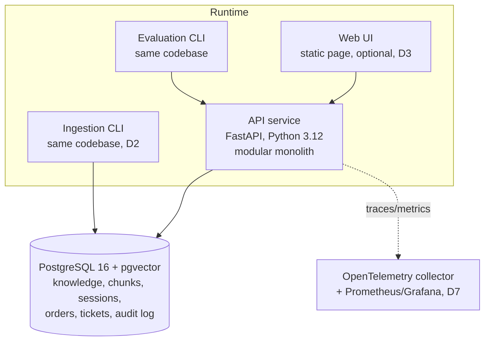
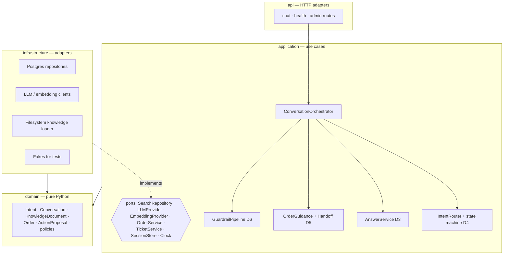
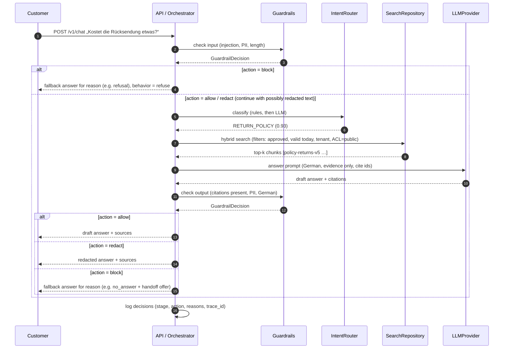
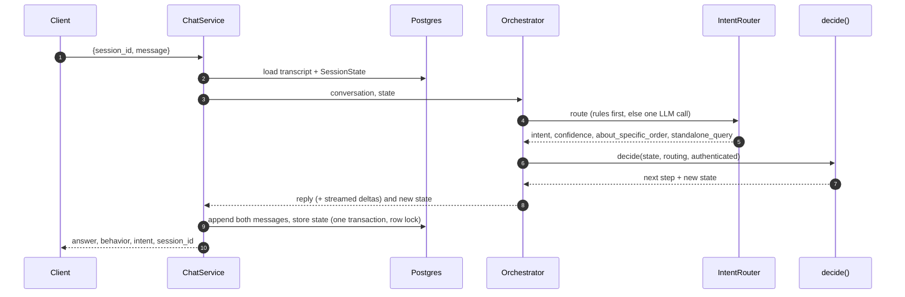
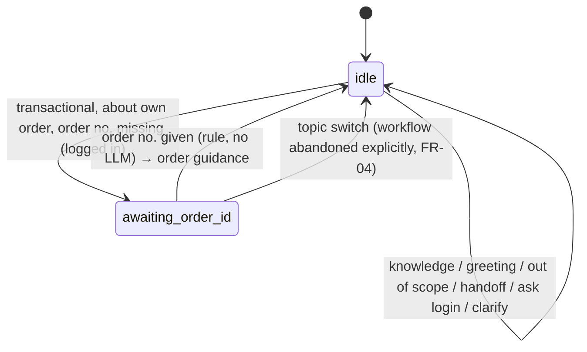
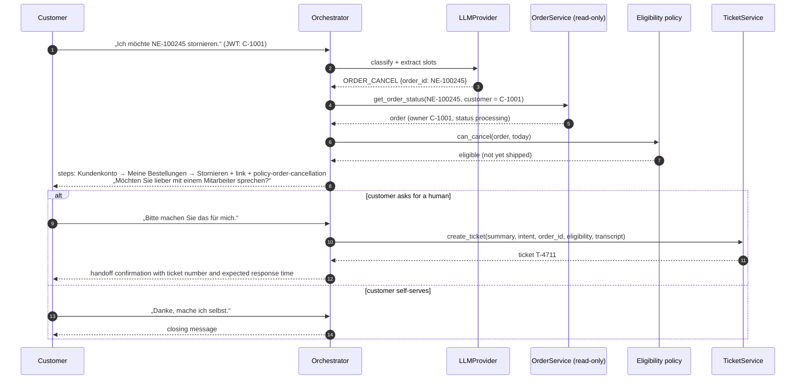
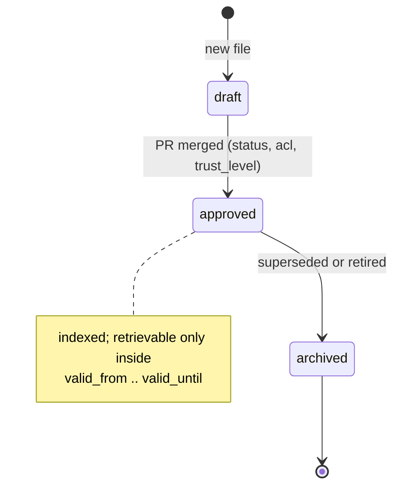
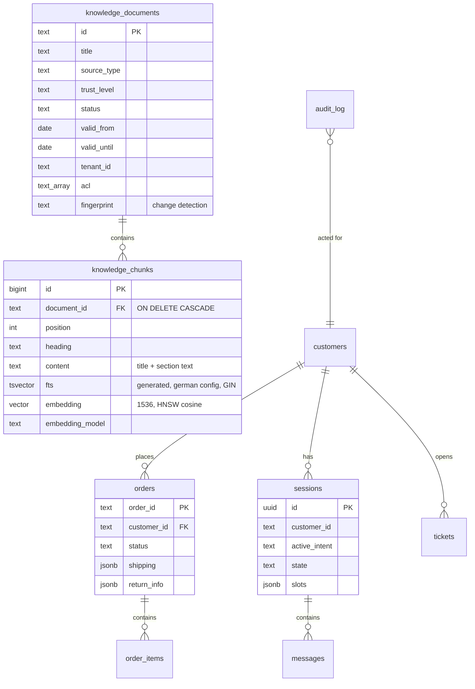

# Architecture

| | |
|---|---|
| **Status** | Baseline (Day 1) — target architecture; components marked with a day are not built yet |
| **Last updated** | 2026-10-05 |
| **Related** | [Requirements](requirements.md) · [Threat model](threat-model.md) · [ADRs](adr/README.md) |

This document follows a lightweight [C4](https://c4model.com/) structure: system context →
containers → components, followed by runtime flows, data model and cross-cutting concerns.

## 1. Architectural drivers

| Driver | Consequence |
|---|---|
| Correctness of policy answers (FR-10–13) | Governed knowledge with versions and validity; retrieval filters; evaluation gate |
| Safe order handling (FR-20–24, NFR-05) | Read-only order access; eligibility in deterministic code; changes only by customer self-service or humans (ADR-0006) |
| German language (LR-01–05) | German full-text configuration, multilingual embeddings, German prompts and eval |
| Learnability and testability | Ports and adapters; every external dependency has a fake |
| Solo, 8 days | Modular monolith, one database, no queue or orchestration platform |

## 2. System context


## 3. Containers



A single Python package (`customer_agent`) provides three entry points: the API, the ingestion
CLI and the evaluation CLI. They share the domain and application layers.
See [ADR-0001](adr/0001-modular-monolith-with-ports-and-adapters.md) and
[ADR-0002](adr/0002-postgresql-pgvector-for-hybrid-retrieval.md).

## 4. Components and layers



**Dependency rule:** `api → application → domain` and `infrastructure → application/domain`.
The domain layer imports nothing from the other layers and performs no I/O. The application layer
depends only on ports (Python `Protocol`s). Adapters are wired together in one composition root
(`main.py` / dependency providers).

| Package | Responsibility | May import |
|---|---|---|
| `domain` | Business concepts and rules (intents, knowledge metadata, order policies) | stdlib, pydantic |
| `application` | Use cases and ports; orchestrates domain objects | `domain` |
| `infrastructure` | Database, LLM, embeddings, filesystem, clock | `application`, `domain`, third-party SDKs |
| `api` | HTTP routing, request/response schemas, auth dependencies | `application`, `domain` |
| `evaluation` | Datasets, scoring, runner | `application`, `domain` |

## 5. Runtime flows

### 5.1 Knowledge question (D3)



#### Guardrail decision contract

Every guardrail check returns a decision, never a bare boolean. The guardrail only **judges**;
the orchestrator **decides what the customer sees**, choosing a German fallback template by
reason. This keeps guardrails pure and testable, and lets different reasons produce different
replies.

```python
class GuardrailAction(StrEnum):
    ALLOW = "allow"  # pass content through unchanged
    REDACT = "redact"  # pass through the modified content (e.g. PII masked)
    BLOCK = "block"  # discard content; orchestrator answers with a fallback


class GuardrailDecision(BaseModel):
    stage: Literal["input", "output"]
    action: GuardrailAction
    reasons: list[str] = []  # reason codes, e.g. "prompt_injection", "missing_citation"
    content: str | None = None  # redacted text when action = REDACT
    scores: dict[str, float] = {}  # detector scores; filled once classifiers exist (D6)
```

**Prior art.** The shape follows established guardrail APIs: AWS Bedrock `ApplyGuardrail`
(`action` + masked `outputs` + `assessments`, with PII actions *block* or *anonymize*) and
Guardrails AI validators (`on_fail`: *noop*, *fix*, *refrain/exception*, *reask*). Simpler
designs exist — the OpenAI Agents SDK uses a boolean tripwire plus info, Llama Guard returns
`safe`/`unsafe` plus category codes — but they cannot express "pass after redaction", which
PII handling (T10) requires. Unlike Bedrock, fallback wording stays in the orchestrator, not in
the guardrail configuration.

| Reason code (examples) | Stage | Typical action | Customer sees |
|---|---|---|---|
| `prompt_injection` | input | block | Polite refusal, offer of supported topics |
| `input_too_long` | input | block | Request to shorten the message |
| `pii_in_input` | input | redact | Normal answer; PII never reaches the LLM or logs |
| `missing_citation` / `ungrounded` | output | block | "No answer" + handoff offer |
| `pii_in_output` | output | redact | Answer with masked values |
| `not_german` | output | block (retry once) | Regenerated German answer, else fallback |

Decisions are logged and exported as metrics (stage, action, reasons) — the basis for the
false-positive and attack-success rates in the evaluation plan.

#### Day 3 implementation notes

- **Relevance gate.** Best cosine similarity < `CA_MIN_ANSWER_SIMILARITY` (0.35) → "no answer"
  without an LLM call. Between the floor and clearly relevant scores the LLM decides and may
  answer `KEINE_ANTWORT`. A single high threshold failed keyword questions such as
  "Nachnahme" (0.447), which overlap with not-in-knowledge-base questions (≤ 0.461).
- **Citations.** The model cites `[document-id]` inline; the customer sees clean text and the
  ids travel as `sources`. Citing an id that was not offered counts as no citation.
- **Prompts** are versioned YAML (`prompts/answer/v2.yaml`, `CA_ANSWER_PROMPT_VERSION`); every
  evaluation result records the prompt ref and model.
- **Streaming** uses the same decision path: the final answer is computed from the full model
  output, and the `final` SSE event is authoritative.

### 5.2 One turn with explicit state (D4)





**Turn lifecycle and concurrency (review fixes, Day 4).** Each turn runs in its own task, decoupled
from the HTTP response: a client disconnect does not lose the turn, and shutdown drains running
turns before closing connections. `chat_sessions.version` (migration 0003) is an optimistic
concurrency token: a turn saves only if the session is still at the version it loaded, so two
simultaneous messages cannot overwrite each other's state (the loser gets `409`).

Steps by intent group: knowledge → grounded answer with the **standalone query** for retrieval
and the customer's original words in the answer prompt; transactional → general question
answered from knowledge, otherwise ask to log in / ask for the order number / order guidance
(Day 5 adds order data); support → handoff (ticket on Day 5); control → greeting (discloses the
AI assistant) or polite refusal. Router confidence < 0.6 → clarification question.

### 5.3 Cancellation request: guidance, then handoff on request (D5 — implemented)



**As implemented:** tool calls are not proposed by the LLM at all. The router extracts the order
number (regex) and the state machine selects the step; the orchestrator calls
`get_order_status` (read-only, ownership in the SQL `WHERE`) or `create_ticket` and writes an
audit entry for each call. Guidance texts are deterministic templates
(`application/order_guidance.py`), because order facts must be exact. Requests about other
people (`third_party` from the router) are refused before any lookup. Authentication:
[ADR-0010](adr/0010-oidc-authentication-with-keycloak.md).

The agent never changes an order ([ADR-0006](adr/0006-no-order-mutations-by-the-agent.md)).
Ownership is checked inside `get_order_status` using the `customer_id` from the verified token;
a foreign or unknown order id yields the same "not found" answer, so the agent does not reveal
that another customer's order exists. Eligibility (`can_cancel`, `can_return`) is deterministic
code with an injected clock; its result only tailors the guidance and enriches the ticket.

## 6. Data model

### 6.1 Knowledge document (source format)

Knowledge is authored as Markdown with YAML front matter in `data/knowledge/`, one file per
document, file name = `id`. Validated by `KnowledgeDocumentMeta`
(`src/customer_agent/domain/knowledge.py`).

| Field | Type | Purpose |
|---|---|---|
| `id` | kebab-case string | Stable identifier, cited in answers |
| `title`, `topic` | string | Display and grouping; `topic` + `source_type=policy` must be unique among active docs |
| `intents` | list of intents | Routing hint and analytics |
| `source_type` | `policy` · `faq` · `product` · `promotion` · `internal` · `community` | Provenance |
| `language` | `de` | Content language |
| `version` | int | Monotonic per topic |
| `valid_from`, `valid_until` | date / null | Validity window (inclusive) |
| `status` | `draft` · `approved` · `archived` | Editorial lifecycle; only `approved` is retrievable |
| `trust_level` | `official` · `internal` · `untrusted` | How much the content may be relied on; untrusted content is treated as data only |
| `tenant_id` | string | Tenant isolation |
| `acl` | list of `public` · `internal` | Who may see it; customers see only `public` |
| `owner` | string | Responsible team |

A document is **retrievable for a customer on date d** iff
`status = approved ∧ valid_from ≤ d ∧ (valid_until is null ∨ d ≤ valid_until) ∧
tenant matches ∧ public ∈ acl`.

### 6.2 Knowledge lifecycle

Git is the source of truth for knowledge; the database is a derived index that can be rebuilt at
any time. The file name equals the document `id` and **never changes** — answers and evaluation
cases cite it. Lifecycle changes are edits to the front matter, reviewed in a pull request.



| Task | Change |
|---|---|
| Write a new policy version | New file `policy-<topic>-v<N>.md` with `status: draft`, `acl: [internal]` |
| Publish | `status: approved`, `acl: [public]`, `trust_level: official` |
| Schedule | Publish in advance with a future `valid_from`; the switch happens at query time, without a deploy |
| Supersede | In the **same** PR, set the previous version's `valid_until` to the day before |
| Retire | `status: archived` (files are never deleted; git history is the audit trail) |

Guarantees:

- `tests/data/test_knowledge_base.py` fails if two approved versions of a policy topic are valid
  on any common date, so a forgotten `valid_until` cannot be merged.
- Ingestion indexes only `approved` documents and removes everything else from the index; queries
  filter again by status, validity, tenant and ACL (defence in depth).
- In production the same fields would be edited through a CMS with a review step; ingestion would
  run automatically on merge to `main`.

### 6.3 Database (D2 onwards)



Knowledge tables are implemented (Day 2, migration `0001`), chat sessions and messages on Day 4
(migration `0002`; the transcript contains customer text, retention 90 days, cleanup job on
Day 7); the other tables arrive with their use cases. Design notes:

- **Filters live on the document**, chunks are joined at query time. At this corpus size a join is
  cheaper than keeping denormalised copies in sync; denormalising filter columns into chunks is the
  usual optimisation at millions of chunks.
- **`fts` is a generated column**, so Postgres keeps it consistent with `content`.
- **`fingerprint`** = SHA-256 over metadata, body, chunker version and embedding model. Unchanged
  fingerprints are skipped, so re-ingestion makes no embedding calls; a model change re-embeds
  everything instead of mixing vector spaces.
- **Replacement is delete-then-insert per document in one transaction** (chunks cascade), which
  is simpler than per-chunk upserts because a document is always replaced as a whole.

### 6.4 Retrieval

1. Lexical: the German lexemes of the query (plus an umlaut-transliterated variant) are
   **OR-combined** and ranked with `ts_rank_cd`. AND semantics (`websearch_to_tsquery`) almost
   never match a full natural-language question.
2. Semantic: cosine distance on the query embedding.
3. Both lists (20 candidates each, searched concurrently) are fused with **weighted Reciprocal
   Rank Fusion** (k = 60, score = Σ wᵢ / (k + rank); full-text weight 0.25, vector 1.0,
   `CA_RETRIEVAL_FULLTEXT_WEIGHT`) and aggregated to documents (document score = best chunk).
   Results keep their `trust_level`.
   RRF scores only express rank, so each hit also keeps its **cosine similarity** — the absolute
   relevance signal for "no answer" decisions (measured on Day 2: answerable ≥ 0.575, not in the
   knowledge base ≤ 0.461, off-topic ≈ 0.30; small sample, threshold to be set on Day 3).
4. Every query applies the scope filters (status, validity on *today*, tenant, ACL) in SQL.

**Full-text weight (Day 5).** With equal weights, frequent policy words ("Rücksendung",
"Bestellung") let lexically similar documents outrank the right one (T-002). The weight was
chosen on `core.jsonl` and then confirmed on `retrieval_holdout.jsonl` (28 new questions, none
shared with `core.jsonl`), hybrid mode, Recall@5 / MRR:

| Full-text weight | `core.jsonl` (36 cases) | `retrieval_holdout.jsonl` (28 cases) |
|---|---|---|
| 1.0 (plain RRF) | 0.972 / 0.873 | 1.000 / 0.833 |
| 0.5 | 1.000 / 0.926 | 1.000 / 0.869 |
| **0.25** | **1.000 / 0.954** | **1.000 / 0.872** |

The gain on the holdout set is smaller than on the set the weight was tuned on — expected, and
the reason for keeping a holdout. Results: `eval/results/day5-retrieval*.json`.

### 6.5 Seed data

`data/seed/customers.json` and `data/seed/orders.json` describe the mock order system. Order
statuses: `pending_payment → paid → processing → shipped → delivered`, plus `cancelled`,
`return_requested`, `returned`. The evaluation reference date is 2026-10-05.

## 7. Cross-cutting concerns

| Concern | Approach | Day |
|---|---|---|
| Configuration | `pydantic-settings`, env prefix `CA_`, `.env` for local only | D1 |
| Language | German FTS config, multilingual embeddings, German prompts; see [ADR-0003](adr/0003-german-language-strategy.md) | D1–D3 |
| Errors | RFC 9457 Problem Details; provider failures (`ProviderUnavailableError`) degrade to a German fallback answer, never `5xx` | D3/D5 |
| Logging | `customer_agent.observability`: one format, request id via `ContextVar` (also while streaming), `key=value` messages with per-step timings; `CA_LOG_LEVEL` | D3 |
| Authentication | Keycloak (OIDC), RS256 JWT verified via JWKS; claims `customer_id`, `tenant_id` ([ADR-0010](adr/0010-oidc-authentication-with-keycloak.md)) | D5 |
| Observability | OpenTelemetry traces, JSON logs with correlation ids, Prometheus metrics | D7 |
| Resilience | Timeouts, retries with backoff, fallbacks to handoff | D7 |
| Testing | Unit (domain, policies) → integration (Postgres) → eval (LLM) → e2e; see [ADR-0004](adr/0004-evaluation-first-with-versioned-datasets.md) | D1+ |

## 8. Repository layout

```text
customer-chatbot/
├── src/customer_agent/
│   ├── domain/            # pure business model
│   ├── application/       # use cases + ports
│   ├── infrastructure/    # adapters (db, llm, filesystem)
│   ├── api/               # FastAPI routers
│   ├── evaluation/        # eval schema, scoring, runner, CLI
│   ├── config.py
│   └── main.py            # app factory / composition root
├── data/
│   ├── knowledge/         # German knowledge base (Markdown + front matter)
│   └── seed/              # customers, orders
├── eval/
│   ├── datasets/          # versioned JSONL datasets
│   └── results/           # stored evaluation runs
├── prompts/               # versioned prompts (D3)
├── tests/
│   ├── unit/
│   ├── integration/       # D2
│   └── data/              # validation of knowledge and datasets
├── docs/                  # requirements, architecture, ADRs, threat model, plans
└── .github/workflows/     # CI
```

## 9. Evolution path

When a measured need appears, the boundaries above allow:

- Replacing pgvector with Azure AI Search or OpenSearch behind `SearchRepository`.
- Moving ingestion and evaluation to background workers behind a queue.
- Extracting the order-tool layer into a separate service when real backends are integrated.
- Adding a second tenant by configuration (tenant id already flows through data and filters).
