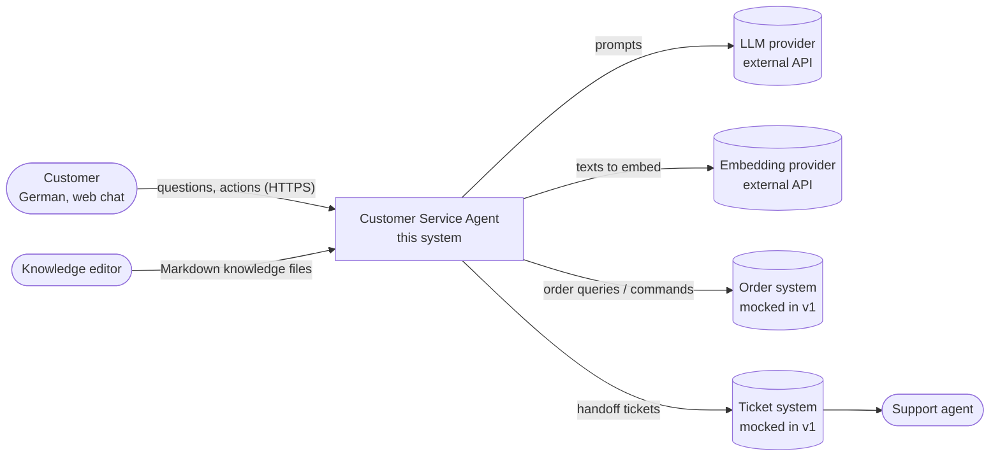
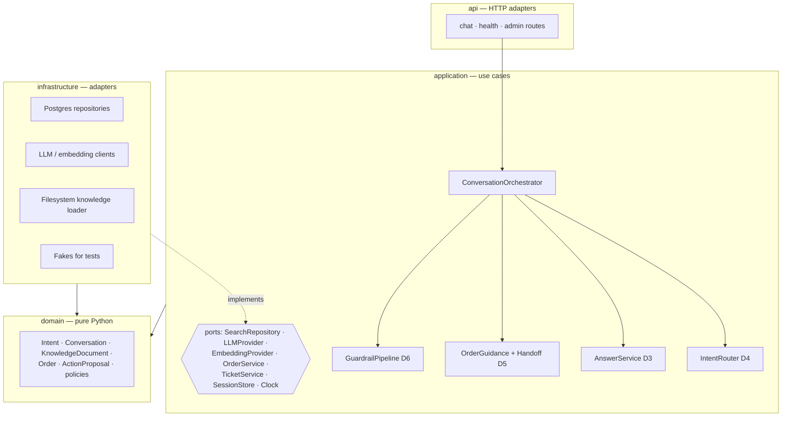
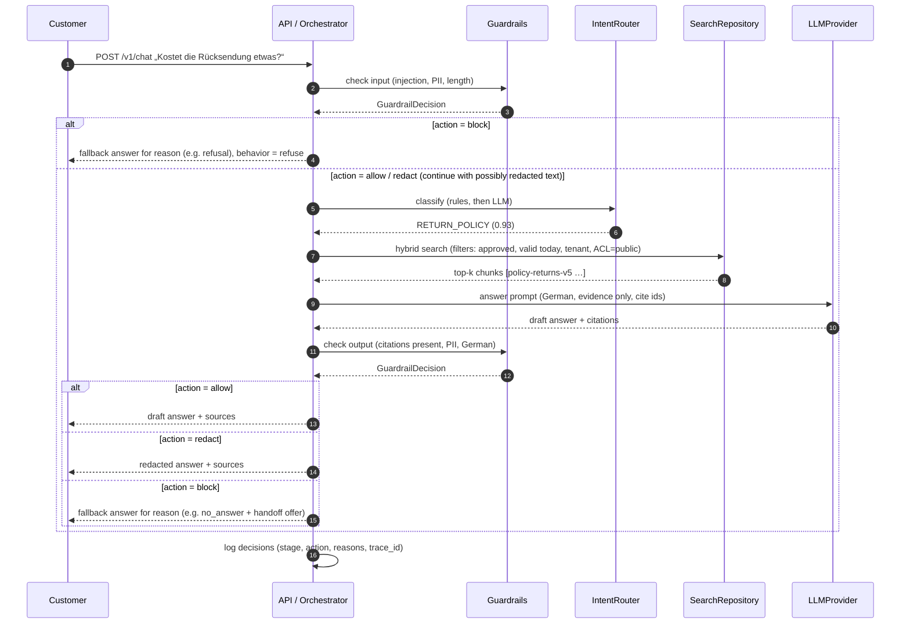
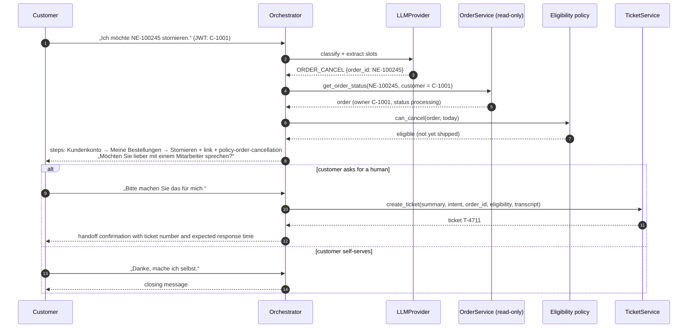
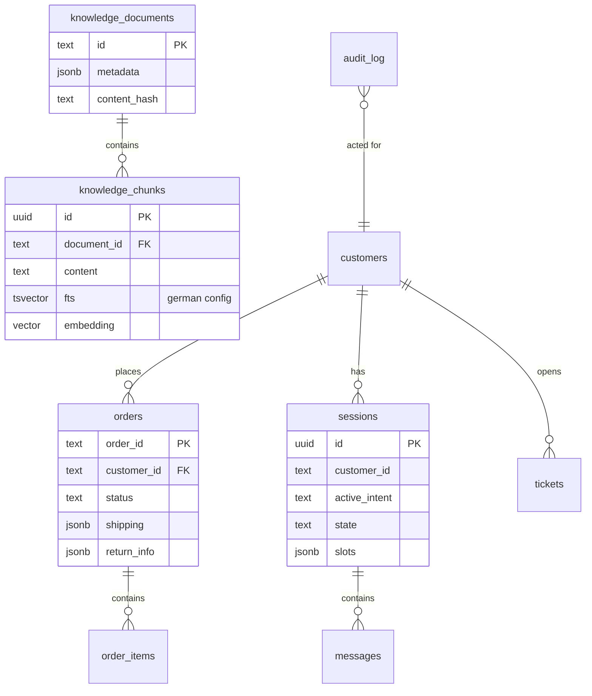

# Architecture

| | |
|---|---|
| **Status** | Baseline (Day 1) — target architecture; components marked with a day are not built yet |
| **Last updated** | 2026-10-05 |
| **Related** | [Requirements](requirements.md) · [Threat model](threat-model.md) · [ADRs](adr/README.md) |

This document follows a lightweight [C4](https://c4model.com/) structure: system context →
containers → components, followed by runtime flows, data model and cross-cutting concerns.

## 1. Architectural drivers

| Driver | Consequence |
|---|---|
| Correctness of policy answers (FR-10–13) | Governed knowledge with versions and validity; retrieval filters; evaluation gate |
| Safe order handling (FR-20–24, NFR-05) | Read-only order access; eligibility in deterministic code; changes only by customer self-service or humans (ADR-0006) |
| German language (LR-01–05) | German full-text configuration, multilingual embeddings, German prompts and eval |
| Learnability and testability | Ports and adapters; every external dependency has a fake |
| Solo, 8 days | Modular monolith, one database, no queue or orchestration platform |

## 2. System context



## 3. Containers


A single Python package (`customer_agent`) provides three entry points: the API, the ingestion
CLI and the evaluation CLI. They share the domain and application layers.
See [ADR-0001](adr/0001-modular-monolith-with-ports-and-adapters.md) and
[ADR-0002](adr/0002-postgresql-pgvector-for-hybrid-retrieval.md).

## 4. Components and layers



**Dependency rule:** `api → application → domain` and `infrastructure → application/domain`.
The domain layer imports nothing from the other layers and performs no I/O. The application layer
depends only on ports (Python `Protocol`s). Adapters are wired together in one composition root
(`main.py` / dependency providers).

| Package | Responsibility | May import |
|---|---|---|
| `domain` | Business concepts and rules (intents, knowledge metadata, order policies) | stdlib, pydantic |
| `application` | Use cases and ports; orchestrates domain objects | `domain` |
| `infrastructure` | Database, LLM, embeddings, filesystem, clock | `application`, `domain`, third-party SDKs |
| `api` | HTTP routing, request/response schemas, auth dependencies | `application`, `domain` |
| `evaluation` | Datasets, scoring, runner | `application`, `domain` |

## 5. Runtime flows

### 5.1 Knowledge question (D3)



#### Guardrail decision contract

Every guardrail check returns a decision, never a bare boolean. The guardrail only **judges**;
the orchestrator **decides what the customer sees**, choosing a German fallback template by
reason. This keeps guardrails pure and testable, and lets different reasons produce different
replies.

```python
class GuardrailAction(StrEnum):
    ALLOW = "allow"  # pass content through unchanged
    REDACT = "redact"  # pass through the modified content (e.g. PII masked)
    BLOCK = "block"  # discard content; orchestrator answers with a fallback


class GuardrailDecision(BaseModel):
    stage: Literal["input", "output"]
    action: GuardrailAction
    reasons: list[str] = []  # reason codes, e.g. "prompt_injection", "missing_citation"
    content: str | None = None  # redacted text when action = REDACT
    scores: dict[str, float] = {}  # detector scores; filled once classifiers exist (D6)
```

**Prior art.** The shape follows established guardrail APIs: AWS Bedrock `ApplyGuardrail`
(`action` + masked `outputs` + `assessments`, with PII actions *block* or *anonymize*) and
Guardrails AI validators (`on_fail`: *noop*, *fix*, *refrain/exception*, *reask*). Simpler
designs exist — the OpenAI Agents SDK uses a boolean tripwire plus info, Llama Guard returns
`safe`/`unsafe` plus category codes — but they cannot express "pass after redaction", which
PII handling (T10) requires. Unlike Bedrock, fallback wording stays in the orchestrator, not in
the guardrail configuration.

| Reason code (examples) | Stage | Typical action | Customer sees |
|---|---|---|---|
| `prompt_injection` | input | block | Polite refusal, offer of supported topics |
| `input_too_long` | input | block | Request to shorten the message |
| `pii_in_input` | input | redact | Normal answer; PII never reaches the LLM or logs |
| `missing_citation` / `ungrounded` | output | block | "No answer" + handoff offer |
| `pii_in_output` | output | redact | Answer with masked values |
| `not_german` | output | block (retry once) | Regenerated German answer, else fallback |

Decisions are logged and exported as metrics (stage, action, reasons) — the basis for the
false-positive and attack-success rates in the evaluation plan.

### 5.2 Cancellation request: guidance, then handoff on request (D5)



The agent never changes an order ([ADR-0006](adr/0006-no-order-mutations-by-the-agent.md)).
Ownership is checked inside `get_order_status` using the `customer_id` from the verified token;
a foreign or unknown order id yields the same "not found" answer, so the agent does not reveal
that another customer's order exists. Eligibility (`can_cancel`, `can_return`) is deterministic
code with an injected clock; its result only tailors the guidance and enriches the ticket.

## 6. Data model

### 6.1 Knowledge document (source format)

Knowledge is authored as Markdown with YAML front matter in `data/knowledge/`, one file per
document, file name = `id`. Validated by `KnowledgeDocumentMeta`
(`src/customer_agent/domain/knowledge.py`).

| Field | Type | Purpose |
|---|---|---|
| `id` | kebab-case string | Stable identifier, cited in answers |
| `title`, `topic` | string | Display and grouping; `topic` + `source_type=policy` must be unique among active docs |
| `intents` | list of intents | Routing hint and analytics |
| `source_type` | `policy` · `faq` · `product` · `promotion` · `internal` · `community` | Provenance |
| `language` | `de` | Content language |
| `version` | int | Monotonic per topic |
| `valid_from`, `valid_until` | date / null | Validity window (inclusive) |
| `status` | `draft` · `approved` · `archived` | Editorial lifecycle; only `approved` is retrievable |
| `trust_level` | `official` · `internal` · `untrusted` | How much the content may be relied on; untrusted content is treated as data only |
| `tenant_id` | string | Tenant isolation |
| `acl` | list of `public` · `internal` | Who may see it; customers see only `public` |
| `owner` | string | Responsible team |

A document is **retrievable for a customer on date d** iff
`status = approved ∧ valid_from ≤ d ∧ (valid_until is null ∨ d ≤ valid_until) ∧
tenant matches ∧ public ∈ acl`.

### 6.2 Database (D2 onwards)



### 6.3 Seed data

`data/seed/customers.json` and `data/seed/orders.json` describe the mock order system. Order
statuses: `pending_payment → paid → processing → shipped → delivered`, plus `cancelled`,
`return_requested`, `returned`. The evaluation reference date is 2026-10-05.

## 7. Cross-cutting concerns

| Concern | Approach | Day |
|---|---|---|
| Configuration | `pydantic-settings`, env prefix `CA_`, `.env` for local only | D1 |
| Language | German FTS config, multilingual embeddings, German prompts; see [ADR-0003](adr/0003-german-language-strategy.md) | D1–D3 |
| Errors | Domain exceptions mapped to RFC 9457 problem responses at the API edge | D3 |
| Authentication | JWT bearer token with `customer_id`, `tenant_id` | D5 |
| Observability | OpenTelemetry traces, JSON logs with correlation ids, Prometheus metrics | D7 |
| Resilience | Timeouts, retries with backoff, fallbacks to handoff | D7 |
| Testing | Unit (domain, policies) → integration (Postgres) → eval (LLM) → e2e; see [ADR-0004](adr/0004-evaluation-first-with-versioned-datasets.md) | D1+ |

## 8. Repository layout

```text
customer-chatbot/
├── src/customer_agent/
│   ├── domain/            # pure business model
│   ├── application/       # use cases + ports
│   ├── infrastructure/    # adapters (db, llm, filesystem)
│   ├── api/               # FastAPI routers
│   ├── evaluation/        # eval schema, scoring, runner, CLI
│   ├── config.py
│   └── main.py            # app factory / composition root
├── data/
│   ├── knowledge/         # German knowledge base (Markdown + front matter)
│   └── seed/              # customers, orders
├── eval/
│   ├── datasets/          # versioned JSONL datasets
│   └── results/           # stored evaluation runs
├── prompts/               # versioned prompts (D3)
├── tests/
│   ├── unit/
│   ├── integration/       # D2
│   └── data/              # validation of knowledge and datasets
├── docs/                  # requirements, architecture, ADRs, threat model, plans
└── .github/workflows/     # CI
```

## 9. Evolution path

When a measured need appears, the boundaries above allow:

- Replacing pgvector with Azure AI Search or OpenSearch behind `SearchRepository`.
- Moving ingestion and evaluation to background workers behind a queue.
- Extracting the order-tool layer into a separate service when real backends are integrated.
- Adding a second tenant by configuration (tenant id already flows through data and filters).
