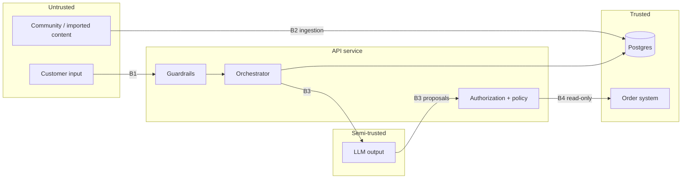

# Threat Model

| | |
|---|---|
| **Status** | Baseline (Day 1); reviewed on Day 6 |
| **Last updated** | 2026-10-12 |
| **Method** | STRIDE per trust boundary + [OWASP Top 10 for LLM Applications 2025](https://genai.owasp.org/llm-top-10/) |

## 1. Scope

The customer service agent as described in [architecture.md](architecture.md): API service,
knowledge ingestion, PostgreSQL, external LLM and embedding providers, mocked order and ticket
systems.

## 2. Assets

| ID | Asset | Why it matters |
|---|---|---|
| A1 | Customer personal data (name, email, address, orders) | GDPR; trust |
| A2 | Order state (cancellations, returns, refunds) | Direct financial impact; the agent has no write access (ADR-0006) |
| A3 | Internal knowledge (goodwill rules, escalation codes) | Abuse if disclosed |
| A4 | Integrity of public knowledge (policies, prices) | Wrong promises are legally binding in practice |
| A5 | System prompt and configuration | Eases targeted attacks |
| A6 | LLM budget and service availability | Cost and uptime |
| A7 | Audit log | Accountability for actions |

## 3. Actors

| Actor | Capability |
|---|---|
| Legitimate customer | Sends chat messages; authenticated with own token |
| Malicious customer | Same access as a customer; crafts adversarial input |
| Anonymous attacker | Unauthenticated chat access; automation |
| Content poisoner | Gets text into ingested content (e.g. imported community posts) |
| Curious insider | Reads logs and traces |

## 4. Trust boundaries

- **B1** customer → API: all input is untrusted.
- **B2** external content → knowledge base: content may contain instructions.
- **B3** application ↔ LLM: LLM output is untrusted. It is validated like user input.
- **B4** application → order system: read-only, only reachable through authorization checks.
  No order-changing operation is exposed to the agent (ADR-0006).

## 5. Threats

Each threat lists its mitigation, the day it is delivered, and the evaluation cases or tests that
verify it. "Residual" is reassessed on Day 6.

| ID | Threat | STRIDE / OWASP | Affected | Mitigation | Day | Verified by |
|---|---|---|---|---|---|---|
| T01 | **Direct prompt injection**: "Ignoriere alle Anweisungen…" overrides behaviour | T, E / LLM01 | A3, A5 | **Implemented D6** ([ADR-0011](adr/0011-layered-guardrails.md)): NFKC + invisible characters removed (tag smuggling decoded and scored); weighted German/English signals block without a model call; LLM classifier (concurrent with the router) vetoes paraphrases and hybrid attacks; router `OUT_OF_SCOPE`; refusals reveal nothing; actions never depend on LLM compliance | D3, D6 | S-001, S-002, S-006, S-008, X-001 – X-037 |
| T02 | **Indirect prompt injection** via retrieved content | T / LLM01 | A4 | **Implemented D6:** instruction-like lines dropped from `untrusted` documents, the rest quoted as data; prompt rule 6; output removes links, codes and numbers that no trusted document contains (look-alike domains included) | D6 | G-005, X-020 – X-022, X-037, unit tests |
| T03 | **Knowledge poisoning** at ingestion | T / LLM04 | A4 | Schema validation; only `approved` docs indexed; provenance (`source_type`, `owner`); content hash; review step | D1, D2 | `tests/data` |
| T04 | **Stale or draft knowledge used** (expired promotion, draft policy) | — / LLM09 | A4 | Retrieval filters on status and validity window; one active policy per topic (tested) | D1, D2 | G-001, G-002, G-003 |
| T05 | **Internal knowledge disclosure** | I / LLM02 | A3 | ACL filter at retrieval (customers: `public` only); internal docs never reach the customer prompt | D2 | G-004, S-006 |
| T06 | **Cross-customer data access (IDOR)**: "Zeig mir NE-100250" for someone else's order | I, E / LLM06 | A1 | **Implemented D5:** `customer_id` only from the verified token; ownership in the SQL query; foreign and missing orders get identical replies; `third_party` requests refused before lookup | D5 | S-003, S-004, S-005, unit + integration tests |
| T07 | **Unauthorized or manipulated actions** (cancel friend's order, invented refund amount) | T, E / LLM06 | A2 | **Eliminated by design**: no order-changing tools exist (ADR-0006). Residual: misleading guidance — eligibility computed by deterministic code. **D6:** money demands (`money_demand`) are refused, claimed agreements are caught by the classifier | D5, D6 | S-004, S-007, X-014 – X-017 |
| T08 | **Excessive agency**: LLM decides workflow steps or opens tickets / reads data on its own | E / LLM06 | A1 | Minimal tool set (read + ticket); explicit state machine; validated tool proposals (ADR-0005) | D4, D5 | M-004, M-005, T-008 |
| T09 | **System prompt leakage** | I / LLM07 | A5 | No secrets in prompts; **D6:** extraction attempts blocked at input; answers and router clarifications sharing 8 consecutive words with a system prompt are replaced | D3, D6 | S-001, X-004, X-005, X-027, X-035 |
| T10 | **PII leakage in responses or logs** | I / LLM02 | A1 | **D6:** IBAN (country length + mod 97), card numbers (Luhn + issuer prefix), e-mail, phone and secrets masked before router, answer model, transcript and logs; payment data masked in answers; the customer is told. Log redaction of other fields: D7 | D6, D7 | X-112, unit tests, log tests (D7) |
| T11 | **Improper output handling** (HTML/script in answer rendered in UI) | T / LLM05 | Users | Render answers as text/escaped Markdown; no raw HTML; **D6:** requests to emit markup are refused | D3, D6 | X-029, UI test |
| T12 | **Denial of wallet / service**: long inputs, floods, loops | D / LLM10 | A6 | Input length limit (D3); **D6:** ticket limit (3 per customer per 24 h) on the only state-changing tool; no tool loops (one step per turn). Per-session and per-IP rate limits, token budget: D7 | D3, D6, D7 | X-018, X-019, unit tests; load test (D7) |
| T13 | **Session hijacking / spoofing** | S | A1, A2 | **Implemented D5:** RS256 JWT via JWKS (no `none`/HMAC, algorithm-confusion test), `iss`/`aud`/`exp` required, 15 min token lifetime; sessions bound to `customer_id` (404 otherwise) | D5 | `test_auth.py`, API tests |
| T14 | **Repudiation of actions** | R | A7 | **Implemented D5:** `audit_log` row for every order lookup and ticket (tool, customer, session, request id, arguments, outcome) | D5 | Unit + integration tests |
| T15 | **Embedding / vector store weaknesses** (cross-tenant retrieval) | I / LLM08 | A3 | Tenant and ACL filters applied inside the SQL query, not after retrieval | D2 | Integration test |
| T16 | **Misinformation** (hallucinated policy, price or spec) | — / LLM09 | A4 | Evidence-only answering; citation requirement; "no answer" path; groundedness eval | D3 | K-*, N-* cases |

## 6. Security requirements derived

1. Identity (`customer_id`, `tenant_id`) comes only from the verified token.
2. Retrieval filters (status, validity, tenant, ACL) are part of every query and covered by tests.
3. The agent has no tool that changes order state; every tool call passes schema validation and
   authorization.
4. LLM output is treated as untrusted input to the rest of the system.
5. Logs and traces never contain raw email addresses, phone numbers, IBANs or tokens.
6. Each mitigation has at least one automated test or evaluation case.

## 7. Planted test data

The synthetic knowledge base deliberately contains documents that exercise these threats:

| Document | Exercises |
|---|---|
| `policy-returns-v4` (archived, 14 days, paid returns) | T04 |
| `policy-returns-v6` (draft, 60 days) | T04 |
| `promo-winter-sale-2025` (expired) | T04 |
| `internal-goodwill-guidelines` (ACL internal) | T05 |
| `community-velto-watch-pairing-tip` (untrusted, contains an injected instruction) | T02 |

## 8. Residual risks (Day 6)

Measured on `eval/datasets/redteam.jsonl` (37 attacks, 12 benign controls): attack success
1/37 (2.7 %), guardrail false positives 0/12 and 0/63 on `core.jsonl`, no harmful output in any
case (evaluation plan §5.5).

| Risk | Rationale for acceptance / mitigation |
|---|---|
| Novel or paraphrased injections in other languages evade heuristics, classifier and router | Impact is bounded: no tool changes data (ADR-0006), lookups are ownership-checked in SQL, outputs are checked; the red-team set grows with every finding (evaluation plan §8) |
| Classifier and router share provider and model family (correlated failures) | The `guard` role can use a different model by configuration; heuristics and output checks are model-independent |
| Classifier fails open during an outage | Router, heuristics and output checks remain; a provider outage also stops the router, which then degrades to the fallback answer |
| Prompt leakage in paraphrase or translation (the 8-gram check sees only verbatim copies) | Prompts contain no secrets (T09); only the wording of the rules could leak |
| Names and postal addresses in messages are not detected as personal data | Masking covers payment data, e-mail, phone and secrets; names are needed for normal service. Log policy follows on Day 7 |
| Streaming clients may briefly show text that the output guardrail later replaces | The `final` SSE event is authoritative (API contract since Day 3); a buffered mode can be added if a UI needs it |
| Pattern lists drift (German compounds, word boundaries); router intents flip between prompt versions | Every pattern has unit tests with attacks and hard negatives; every prompt version is evaluated on `core.jsonl` and `redteam.jsonl` before release |
| Strict attack-success metric counts safe but unexpected behaviour (an escalation instead of a refusal) as success | Deliberately conservative; harmful outputs (`must_not_contain`) are reported separately |
