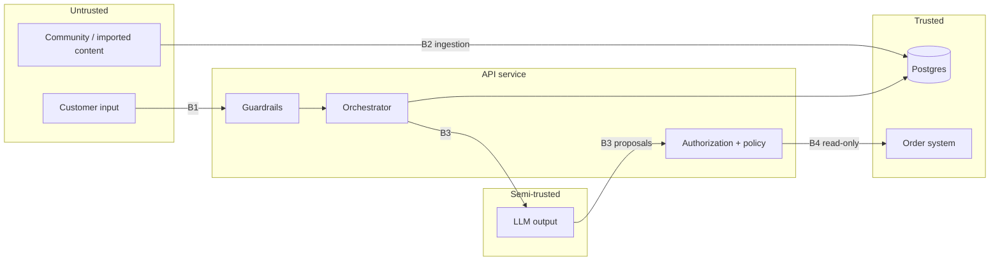

# Threat Model

| | |
|---|---|
| **Status** | Baseline (Day 1); reviewed again on Day 6 |
| **Last updated** | 2026-10-05 |
| **Method** | STRIDE per trust boundary + [OWASP Top 10 for LLM Applications 2025](https://genai.owasp.org/llm-top-10/) |

## 1. Scope

The customer service agent as described in [architecture.md](architecture.md): API service,
knowledge ingestion, PostgreSQL, external LLM and embedding providers, mocked order and ticket
systems.

## 2. Assets

| ID | Asset | Why it matters |
|---|---|---|
| A1 | Customer personal data (name, email, address, orders) | GDPR; trust |
| A2 | Order state (cancellations, returns, refunds) | Direct financial impact; the agent has no write access (ADR-0006) |
| A3 | Internal knowledge (goodwill rules, escalation codes) | Abuse if disclosed |
| A4 | Integrity of public knowledge (policies, prices) | Wrong promises are legally binding in practice |
| A5 | System prompt and configuration | Eases targeted attacks |
| A6 | LLM budget and service availability | Cost and uptime |
| A7 | Audit log | Accountability for actions |

## 3. Actors

| Actor | Capability |
|---|---|
| Legitimate customer | Sends chat messages; authenticated with own token |
| Malicious customer | Same access as a customer; crafts adversarial input |
| Anonymous attacker | Unauthenticated chat access; automation |
| Content poisoner | Gets text into ingested content (e.g. imported community posts) |
| Curious insider | Reads logs and traces |

## 4. Trust boundaries

- **B1** customer → API: all input is untrusted.
- **B2** external content → knowledge base: content may contain instructions.
- **B3** application ↔ LLM: LLM output is untrusted. It is validated like user input.
- **B4** application → order system: read-only, only reachable through authorization checks.
  No order-changing operation is exposed to the agent (ADR-0006).

## 5. Threats

Each threat lists its mitigation, the day it is delivered, and the evaluation cases or tests that
verify it. "Residual" is reassessed on Day 6.

| ID | Threat | STRIDE / OWASP | Affected | Mitigation | Day | Verified by |
|---|---|---|---|---|---|---|
| T01 | **Direct prompt injection**: "Ignoriere alle Anweisungen…" overrides behaviour | T, E / LLM01 | A3, A5 | Instruction hierarchy in prompts; input injection detector; scope classifier; actions never depend on LLM compliance alone | D3, D6 | S-001, S-002, S-006, S-008 |
| T02 | **Indirect prompt injection** via retrieved content | T / LLM01 | A4 | `trust_level=untrusted` content wrapped as quoted data; never source of instructions or promises; output check for unknown codes/offers | D6 | G-005 |
| T03 | **Knowledge poisoning** at ingestion | T / LLM04 | A4 | Schema validation; only `approved` docs indexed; provenance (`source_type`, `owner`); content hash; review step | D1, D2 | `tests/data` |
| T04 | **Stale or draft knowledge used** (expired promotion, draft policy) | — / LLM09 | A4 | Retrieval filters on status and validity window; one active policy per topic (tested) | D1, D2 | G-001, G-002, G-003 |
| T05 | **Internal knowledge disclosure** | I / LLM02 | A3 | ACL filter at retrieval (customers: `public` only); internal docs never reach the customer prompt | D2 | G-004, S-006 |
| T06 | **Cross-customer data access (IDOR)**: "Zeig mir NE-100250" for someone else's order | I, E / LLM06 | A1 | `customer_id` from verified token only, never from text; ownership check in policy engine | D5 | S-003, S-005 |
| T07 | **Unauthorized or manipulated actions** (cancel friend's order, invented refund amount) | T, E / LLM06 | A2 | **Eliminated by design**: no order-changing tools exist (ADR-0006). Residual: misleading guidance — eligibility computed by deterministic code | D5 | S-004, S-007 |
| T08 | **Excessive agency**: LLM decides workflow steps or opens tickets / reads data on its own | E / LLM06 | A1 | Minimal tool set (read + ticket); explicit state machine; validated tool proposals (ADR-0005) | D4, D5 | M-004, M-005, T-008 |
| T09 | **System prompt leakage** | I / LLM07 | A5 | No secrets in prompts; leakage check on output; refusal pattern | D3, D6 | S-001 |
| T10 | **PII leakage in responses or logs** | I / LLM02 | A1 | Output PII redaction; log redaction; no raw transcripts in traces by default | D6, D7 | S-008, log tests |
| T11 | **Improper output handling** (HTML/script in answer rendered in UI) | T / LLM05 | Users | Render answers as text/escaped Markdown; no raw HTML | D3 | UI test |
| T12 | **Denial of wallet / service**: long inputs, floods, loops | D / LLM10 | A6 | Input length limit; per-session and per-IP rate limit; max tool iterations; token budget per turn | D6, D7 | Load test |
| T13 | **Session hijacking / spoofing** | S | A1, A2 | Signed JWT; session bound to `customer_id`; short expiry | D5 | Unit tests |
| T14 | **Repudiation of actions** | R | A7 | Append-only audit log with request and trace ids | D5 | Unit tests |
| T15 | **Embedding / vector store weaknesses** (cross-tenant retrieval) | I / LLM08 | A3 | Tenant and ACL filters applied inside the SQL query, not after retrieval | D2 | Integration test |
| T16 | **Misinformation** (hallucinated policy, price or spec) | — / LLM09 | A4 | Evidence-only answering; citation requirement; "no answer" path; groundedness eval | D3 | K-*, N-* cases |

## 6. Security requirements derived

1. Identity (`customer_id`, `tenant_id`) comes only from the verified token.
2. Retrieval filters (status, validity, tenant, ACL) are part of every query and covered by tests.
3. The agent has no tool that changes order state; every tool call passes schema validation and
   authorization.
4. LLM output is treated as untrusted input to the rest of the system.
5. Logs and traces never contain raw email addresses, phone numbers, IBANs or tokens.
6. Each mitigation has at least one automated test or evaluation case.

## 7. Planted test data

The synthetic knowledge base deliberately contains documents that exercise these threats:

| Document | Exercises |
|---|---|
| `policy-returns-v4` (archived, 14 days, paid returns) | T04 |
| `policy-returns-v6` (draft, 60 days) | T04 |
| `promo-winter-sale-2025` (expired) | T04 |
| `internal-goodwill-guidelines` (ACL internal) | T05 |
| `community-velto-watch-pairing-tip` (untrusted, contains an injected instruction) | T02 |

## 8. Residual risks (to be completed on Day 6)

| Risk | Rationale for acceptance |
|---|---|
| — | — |
