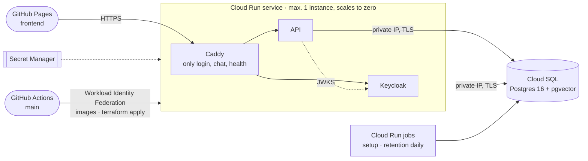

# Hosted backend on Google Cloud

The browser demo's backend as a Cloud Run service, with Cloud SQL for PostgreSQL. It is the
tunnel demo (`infra/demo`) moved to the cloud: the same three containers, the same route filter.



| | |
|---|---|
| Address | `https://customer-agent-865980992655.europe-west1.run.app`, the frontend's default backend |
| Project | `nordelektro-agent` (its own project: costs and permissions stay separate) |
| Login | The three demo customers, with a generated password; no registration, no password grant |
| Not reachable | Keycloak admin and account consoles, the master realm, `/metrics`, API docs (404) |
| Cost | About $10 a month for Cloud SQL (`db-f1-micro`); Cloud Run within its free tier at demo traffic. A budget alert mails at 50, 90 and 100 % of $20 |

## Deploy

**From `main`, automatically.** Every push to `main` that passes the four CI jobs is deployed
by the `deploy` job in [`ci.yml`](../../.github/workflows/ci.yml): it builds and pushes the API,
Keycloak and proxy images (tag: the commit), applies the Terraform in this directory, runs the
`setup` job (migrations, demo orders, knowledge index, all idempotent) and waits until
`/health/ready` answers. It signs in through Workload Identity Federation as the `deployer`
service account: only this repository's `main` branch gets a token, and GitHub stores no key.
The job needs no `.env` and no model key; it reads the settings that `make gcp-deploy` saved
beside the Terraform state.

**From this machine**, for the first deploy, changed model settings and every change the
deployer may not make (below). Needs `gcloud` (logged in), `terraform` ≥ 1.11, Docker, and in
`.env` besides the model keys: `GCP_PROJECT_ID`, `GCP_BILLING_ACCOUNT` (optional `GCP_REGION`,
default `europe-west1`).

```bash
make gcp-plan     # what would change
make gcp-deploy   # project, state bucket and missing keys if needed, settings for CI, then as CI
```

A change to the infrastructure (IAM, secrets, network, database, scheduler) is applied with
`make gcp-deploy` from its branch before the merge; the deploy job then finds only the images
left to change. Every deploy creates a new revision; the first request after an idle period
waits about 15 seconds while Keycloak starts.

The demo password (in your terminal; share it only with whom you give the link):

```bash
gcloud secrets versions access latest --secret demo-password --project nordelektro-agent
```

## Operate

| | |
|---|---|
| Logs | Cloud Logging, one JSON line per event (`request_id`, `session_id`, `trace_id`); traces in Langfuse when its keys are in `.env` |
| Retention | The `retention` job runs daily at 03:00 (Europe/Berlin) via Cloud Scheduler |
| Between demos | `make gcp-pause` stops Cloud SQL (storage is still billed), `make gcp-resume` starts it |
| New model key | Change it in `.env`, `make gcp-secrets`: new versions, which new instances read |
| New model settings | Change them in `.env`, `make gcp-deploy`: deployed and saved for CI |
| Remove | `make gcp-destroy` (asks first), then `gcloud projects delete nordelektro-agent` |

## Notes

- **Secrets.** The model and Langfuse keys go from `.env` to Secret Manager through gcloud
  (`make gcp-secrets`; `make gcp-deploy` adds missing ones). Terraform creates the secrets but
  never sees their values, so neither its state nor CI holds a key. The generated database,
  Keycloak admin and demo passwords are in the state.
- **State.** In the bucket `nordelektro-agent-tfstate` (versioned, no public access), shared by
  CI and this machine and locked during an apply. It holds the generated passwords: only the
  owner and the deployer can read it.
- **The deployer** reads everything this configuration manages, so that it can plan, and
  changes only images, revisions and job runs: Viewer and Security Reviewer, Cloud Run
  Developer, Artifact Registry writer on the repository, object admin on the state bucket, read
  access to the generated secrets (the state holds them anyway) and Billing Account Viewer for
  the budget. It cannot change IAM ([`github.tf`](github.tf)).
- **One instance.** Keycloak keeps its caches in memory, so the service never runs a second
  instance. The database pools are small to stay below the instance's 50 connections.
- **The realm is imported once**, on Keycloak's first start against an empty database. Later
  changes to `infra/keycloak/nordelektro-realm.json` or a new demo password do not reach the
  running realm by a deploy.
- **The hosted realm** is derived from the development realm by `keycloak/realm.py`: the
  development password is replaced, HTTPS is required, the password grant is off, and logins
  redirect only to GitHub Pages.
