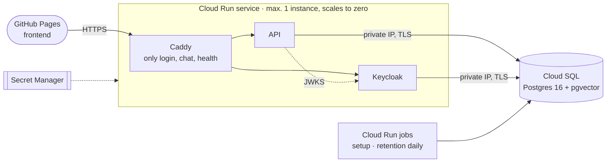

# Hosted backend on Google Cloud

The browser demo's backend as a Cloud Run service, with Cloud SQL for PostgreSQL. It is the
tunnel demo (`infra/demo`) moved to the cloud: the same three containers, the same route filter.



| | |
|---|---|
| Address | `https://customer-agent-865980992655.europe-west1.run.app`, the frontend's default backend |
| Project | `nordelektro-agent` (its own project: costs and permissions stay separate) |
| Login | The three demo customers, with a generated password; no registration, no password grant |
| Not reachable | Keycloak admin and account consoles, the master realm, `/metrics`, API docs (404) |
| Cost | About $10 a month for Cloud SQL (`db-f1-micro`); Cloud Run within its free tier at demo traffic. A budget alert mails at 50, 90 and 100 % of $20 |

## Deploy

Needs `gcloud` (logged in), `terraform` ≥ 1.11, Docker, and in `.env` besides the model keys:
`GCP_PROJECT_ID`, `GCP_BILLING_ACCOUNT` (optional `GCP_REGION`, default `europe-west1`).

```bash
make gcp-plan     # what would change
make gcp-deploy   # create the project if needed, push images (tag: commit), apply, run setup
```

`make gcp-deploy` builds the API, Keycloak and proxy images, applies the Terraform in this
directory and runs the `setup` job: migrations, demo orders and the knowledge index, all
idempotent. Every deploy creates a new revision; the first request after an idle period waits
about 15 seconds while Keycloak starts.

The demo password (in your terminal; share it only with whom you give the link):

```bash
gcloud secrets versions access latest --secret demo-password --project nordelektro-agent
```

## Operate

| | |
|---|---|
| Logs | Cloud Logging, one JSON line per event (`request_id`, `session_id`, `trace_id`); traces in Langfuse when its keys are in `.env` |
| Retention | The `retention` job runs daily at 03:00 (Europe/Berlin) via Cloud Scheduler |
| Between demos | `make gcp-pause` stops Cloud SQL (storage is still billed), `make gcp-resume` starts it |
| New model key | Change it in `.env`, set `GCP_SECRETS_VERSION` one higher, `make gcp-deploy` |
| Remove | `make gcp-destroy` (asks first), then `gcloud projects delete nordelektro-agent` |

## Notes

- **Secrets.** The model and Langfuse keys go from `.env` to Secret Manager as write-only
  values; the Terraform state does not hold them. The generated database, Keycloak admin and
  demo passwords are in the local state (`terraform.tfstate`, git-ignored, mode 600): keep it
  private.
- **One instance.** Keycloak keeps its caches in memory, so the service never runs a second
  instance. The database pools are small to stay below the instance's 50 connections.
- **The realm is imported once**, on Keycloak's first start against an empty database. Later
  changes to `infra/keycloak/nordelektro-realm.json` or a new demo password do not reach the
  running realm by a deploy.
- **The hosted realm** is derived from the development realm by `keycloak/realm.py`: the
  development password is replaced, HTTPS is required, the password grant is off, and logins
  redirect only to GitHub Pages.
